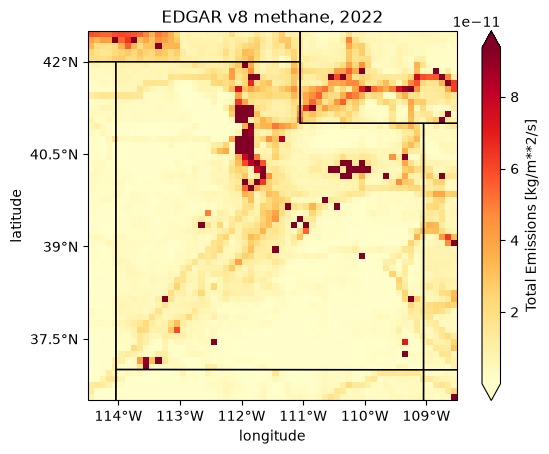
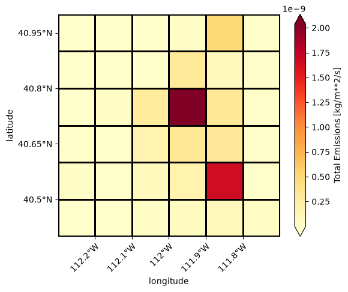
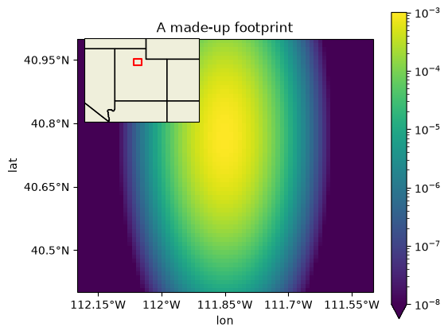

Draw a map of an inventory
==========================

This example draws a map of EDGAR's methane emissions over Utah in 2022, adds
state lines and tick labels, outlines the grid cells, and puts a small map of
where it is in a corner. It ends with a field that is not an inventory. Three
rules come out of it:

* **Inventory.plot averages every time step, and reads all of them.** For
  EDGAR v8's 53 years that takes about a minute. Pass ``time=`` to draw one (see
  `Plot one year`_).
* **lair draws the field, and you add the map.** ``plot`` returns a cartopy
  axes with only the field on it. State lines and coastlines are cartopy
  features, and :func:`~lair.geo.add_latlon_ticks` writes the tick labels in
  degrees (see `State lines and tick labels`_).
* **The map helpers take an extent**, ``[west, east, south, north]``. ``clip``
  takes the same extent, or a bbox, ``(west, south, east, north)``: the same
  four numbers in another order. :func:`~lair.geo.bbox2extent` converts.

.. note::

   This page does not run when the docs build. It needs the ``geo`` and
   ``science`` extras (see :ref:`optional-dependencies`), EDGAR's files, and the
   internet the first time cartopy draws a feature. The output and the figures
   below were recorded from one run of this code on 2026-10-14.

The data
--------

EDGAR v8's methane files, laid out as in :ref:`the inventory example
<inventory-data>`, under ``LAIR_INVENTORY_DIR`` (see :ref:`data-locations`).
Drawing a map needs no ESMF, which the inventory example needs for its totals.

.. _maps-plot:

Plot one year
-------------

:meth:`~lair.inventories.Inventory.plot` draws ``total_emissions``: the sum of
the sectors in each cell, a flux in kg m-2 s-1. With no ``time`` it first takes
the mean over every time step, so it reads every file. Here that is the 53
years of EDGAR v8's methane, on the whole globe, and it takes about a minute:

.. code-block:: ipython

   In [1]: import time
      ...:
      ...: from lair.inventories import EDGARv8
      ...:
      ...: inv = EDGARv8("CH4")
      ...:
      ...: t0 = time.time()
      ...: ax = inv.plot()
      ...: print(f"mean of every year: {time.time() - t0:.0f} s")
   mean of every year: 51 s

``time`` picks one step instead: an integer position (``-1`` is the last), or a
label such as ``"2022-01-01"``. EDGAR's annual steps are labeled by the start of
the year (see :doc:`inventory`). Reading one year is far quicker:

.. code-block:: ipython

   In [2]: t0 = time.time()
      ...: ax = inv.plot(time="2022-01-01")
      ...: print(f"2022 only: {time.time() - t0:.0f} s")
   2022 only: 3 s

``sector=`` draws one sector instead of the total. Use a name from
``inv.data.data_vars``, spelled as it is there (``"Power_Industry"``).

State lines and tick labels
---------------------------

A whole-globe map is no use for Utah, so clip first. This extent, in degrees
and in the order the map helpers want, holds 60 by 60 cells of 0.1 degrees:

.. code-block:: ipython

   In [3]: import cartopy.feature as cfeature
      ...:
      ...: from lair import geo
      ...:
      ...: extent = [-114.5, -108.5, 36.5, 42.5]  # west, east, south, north
      ...: utah = inv.clip(extent=extent)
      ...: utah.data.sizes
   Out[3]: Frozen({'time': 53, 'lat': 60, 'lon': 60})

``plot`` passes its other arguments to xarray's plot. ``cmap`` picks the colors,
and ``robust=True`` sets the color range from the 2nd to the 98th percentile of
the values, so the few largest sources do not set it. xarray titles the plot
with the scalar coordinates it finds (``time = 2022-01-01, spatial_ref = 0``),
so set a title of your own. ``plot`` returns the axes, and ``add_feature`` and
:func:`~lair.geo.add_latlon_ticks` draw on it:

.. code-block:: ipython

   In [4]: ax = utah.plot(time="2022-01-01", robust=True, cmap="YlOrRd")
      ...: ax.set_title("EDGAR v8 methane, 2022")
      ...: ax.add_feature(cfeature.STATES, edgecolor="black", facecolor="none")
      ...: geo.add_latlon_ticks(ax, extent)
      ...: ax.figure.savefig("maps_inventory.png", dpi=100, bbox_inches="tight")

cartopy downloads the state lines from `Natural Earth
<https://www.naturalearthdata.com/>`_ the first time it draws them, and prints
a ``DownloadWarning``. That needs the internet once: cartopy keeps the file in
its data folder and reads it from there afterward. The size of that folder, in
megabytes, after the map above:

.. code-block:: ipython

   In [5]: from pathlib import Path
      ...:
      ...: import cartopy
      ...:
      ...: data_dir = Path(cartopy.config["data_dir"])
      ...: round(sum(f.stat().st_size for f in data_dir.rglob("*") if f.is_file()) / 1e6, 1)
   Out[5]: 36.4

``ax.coastlines()`` draws a coast in the same way. ``add_latlon_ticks`` needs a
rectangular map such as the PlateCarree one ``plot`` makes; on a projected axes
(Lambert, for example) it raises ``RuntimeError: Cannot handle non-rectangular
coordinate systems.``

To draw on axes of your own, such as a panel of a larger figure or a projected
map, pass ``ax=``. ``plot`` draws the inventory in longitude and latitude and
cartopy transforms it, so any cartopy axes works.

The grid
--------

:func:`~lair.geo.plot_grid` outlines the cells of a grid on the axes you give
it. It draws with xarray's plot, which adds a colorbar, and passes its other
arguments on, so ``add_colorbar=False`` leaves the colorbar out. Here it
outlines the Salt Lake Valley box of the :doc:`inventory example <inventory>`
(there as a bbox), 6 by 6 cells of 0.1 degrees, over a map of its emissions. A
small map has many close ticks, so ``x_rotation=45`` tilts the longitude
labels:

.. code-block:: ipython

   In [6]: slv_extent = [-112.3, -111.7, 40.4, 41.0]
      ...: slv = inv.clip(extent=slv_extent)
      ...: ax = slv.plot(time="2022-01-01", robust=True, cmap="YlOrRd")
      ...: ax.set_title("EDGAR v8 methane, 2022")
      ...: geo.plot_grid(slv.data, ax=ax, add_colorbar=False)
      ...: geo.add_latlon_ticks(ax, slv_extent, x_rotation=45)
      ...: ax.figure.savefig("maps_grid.png", dpi=100, bbox_inches="tight")

With no ``ax``, ``plot_grid`` makes a map of its own. Give it ``extent=`` in
longitude and latitude to set the view, and ``crs=`` (an EPSG code such as
``5070``, or a cartopy projection) to draw on a projected map; the extent is
still in degrees.

Another field, and where it is
------------------------------

Any ``DataArray`` with ``lat`` and ``lon`` coordinates can be drawn on the same
kind of map, so a footprint or a model field gets state lines, tick labels and a
grid in the same way. With xarray's own ``plot``, pass ``transform=`` to say
that the coordinates are degrees, as ``Inventory.plot`` does for you. Here is a
made-up footprint on a 0.01 degree grid from
:func:`~lair.geo.generate_regular_grid`, longer north to south than east to
west, around a point in the Salt Lake Valley:

.. code-block:: ipython

   In [7]: import cartopy.crs as ccrs
      ...: import matplotlib.pyplot as plt
      ...: import numpy as np
      ...: from matplotlib.colors import LogNorm
      ...:
      ...: grid = geo.generate_regular_grid(-112.2, -111.5, 0.01, 40.4, 41.0, 0.01, x_label="lon", y_label="lat")
      ...: east = (grid.lon + 111.85) * np.cos(np.deg2rad(40.77))  # degrees from the point
      ...: north = grid.lat - 40.77
      ...: sx, sy = 0.04, 0.12  # widths of the plume, in degrees
      ...: footprint = 1e-3 * np.exp(-(east**2 / (2 * sx**2) + north**2 / (2 * sy**2)))
      ...: footprint.sizes
   Out[7]: Frozen({'lon': 70, 'lat': 60})

:func:`~lair.geo.add_extent_map` adds a small map of where the main map is, in
the corner of the figure. It takes the main map's extent and projection, the
inset's position in the figure as ``(left, bottom, width, height)``, fractions
of the figure's size, its own extent and projection, and the color and width of
the outline it draws around the main extent:

.. code-block:: ipython

   In [8]: fig, ax = plt.subplots(figsize=(6, 5), subplot_kw={"projection": ccrs.PlateCarree()})
      ...: footprint.plot(ax=ax, x="lon", y="lat", transform=ccrs.PlateCarree(), norm=LogNorm(vmin=1e-8, vmax=1e-3))
      ...: ax.set_title("A made-up footprint")
      ...: main_extent = [-112.2, -111.5, 40.4, 41.0]
      ...: geo.add_latlon_ticks(ax, main_extent)
      ...: geo.add_extent_map(
      ...:     fig,
      ...:     main_extent=main_extent,
      ...:     main_extent_crs=ccrs.PlateCarree(),
      ...:     extent_map_rect=(0.14, 0.58, 0.24, 0.26),
      ...:     extent_map_extent=[-117, -106, 35, 43],
      ...:     extent_map_crs=ccrs.PlateCarree(),
      ...:     color="red",
      ...:     linewidth=1.5,
      ...: )
      ...: fig.savefig("maps_footprint.png", dpi=100, bbox_inches="tight")

Next
----

:mod:`lair.geo` also has :func:`~lair.geo.add_lat_ticks` and
:func:`~lair.geo.add_lon_ticks`, for a map that needs only one axis labeled.
